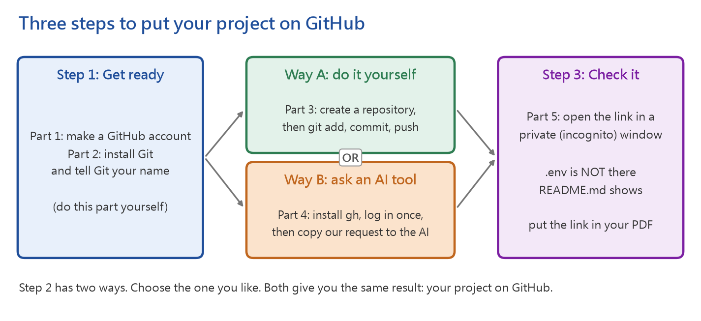
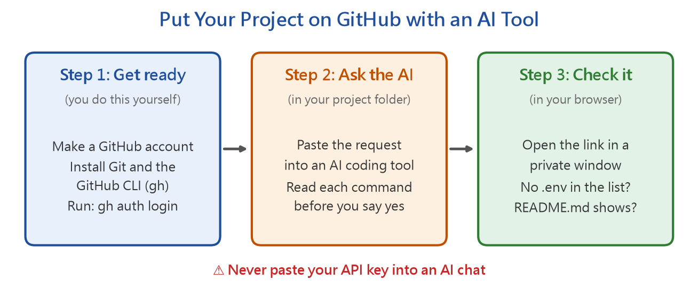

# How to Put Your Project on GitHub: Make an Account, Upload from Your Computer, or Ask an AI Tool

You hand in your code on **GitHub**, a website that keeps your code online and shows it to other people.
This guide shows you how to get there, even if you have never used it.

> **For your reference (FYR).** You do not hand in anything from this guide.
> Use the parts you need. If you already know Git and GitHub, you can skip it.



There are two words you will see many times:

- **Git** is a program on your computer. It records versions of your code and uploads them.
- A **repository** (repo, 專案) is one project on GitHub. Each homework is one repository.

## 1. Make a GitHub account

1. Go to <https://github.com/signup>.
2. Enter your email, a password and a **username**. Your username is part of every link you share,
   such as `https://github.com/your-username`, so choose one you are happy to show a teacher or an employer.
3. Solve the puzzle, and type the code that GitHub sends to your email.
4. When GitHub asks you to set up **two-factor authentication** (2FA, 雙重驗證), do it.
   Use an app on your phone, such as Google Authenticator or Microsoft Authenticator.
   **Save the recovery codes** somewhere safe. Without them, a lost phone can lock you out of your account.

## 2. Install Git and tell it your name

1. Download Git from <https://git-scm.com> and install it. On Windows, the default choices are fine.
2. Open a console (終端機): on Windows, open **Git Bash** or **PowerShell**; on macOS, open **Terminal**.
3. Tell Git your name and email. Git writes them on every version you save.
   Use the same email as your GitHub account:

   ```bash
   git config --global user.name "Your Name"
   git config --global user.email "you@example.com"
   ```

4. Check that it works:

   ```bash
   git --version
   ```

You only do parts 1 and 2 once. After that, choose **Way A** (part 3) or **Way B** (part 4).

## 3. Way A: Upload your project yourself

### 3.1 Get your project folder ready

Your folder must have these files before you upload it (see part 7.2 of the homework guide):
your code, your CSV files, `.env.example`, `requirements.txt`, `README.md` (copy it from `(FYR) README-Template.md` in this folder)
and `.gitignore`.

Make a file named **`.gitignore`** in your project folder with this content.
It tells Git which files must **never** be uploaded. `*.db` keeps the database file out,
because your program builds it again from the CSV files:

```text
.env
*.db
__pycache__/
venv/
.venv/
node_modules/
build/
dist/
```

### 3.2 Create an empty repository on GitHub

1. Log in to GitHub, click **+** at the top right, and choose **New repository**.
2. Type a name, such as `my-customer-service`.
3. Choose **Public**.
4. **Do not** tick "Add a README file", and leave ".gitignore" and "license" as "None".
   Your project already has these files. If GitHub also makes them, your first upload will be refused.
5. Click **Create repository**. Keep this page open. It shows the link to your repository.

### 3.3 Upload with five commands

Open a console **in your project folder**. (In VS Code, choose Terminal > New Terminal.)
Run these commands one at a time. Change `your-username` and `my-customer-service` to your own:

```bash
git init
git add .
git status
```

`git init` starts Git in this folder. `git add .` chooses all files to upload,
except the ones in `.gitignore`. `git status` shows the list of chosen files.

**Stop and read the list.** If you see `.env` in it, do not go on. Check that `.gitignore` is in the
same folder and that its name is exactly `.gitignore`, then run `git rm --cached .env` and `git status` again.

When the list is right, save a version and upload it:

```bash
git commit -m "First version of my customer service bot"
git branch -M main
git remote add origin https://github.com/your-username/my-customer-service.git
git push -u origin main
```

`git commit` saves a version with a short message. `git remote add` tells Git where your repository is.
`git push` uploads it.

The first time you push, a browser window opens and asks you to log in to GitHub. Log in, and the upload goes on.
Then refresh your repository page. Your files are there.

### 3.4 Upload your changes later

Each time you change your code, run these three commands in the same folder:

```bash
git add .
git commit -m "Add a tool that checks free tables"
git push
```

Write a message that says what you changed. "update" or "fix" alone does not help anyone.

> **If you like buttons more than commands:** VS Code can do the same work.
> Open your project folder, click the **Source Control** icon on the left,
> and click **Publish to GitHub**. Choose **public repository**, and check the file list before you confirm.
> Later, type a message, click **Commit**, then click **Sync Changes**.

## 4. Way B: Ask an AI tool to upload your project

An AI coding tool can run the Git commands for you.



### 4.1 Get ready (you must do this part yourself)

1. Finish parts 1 and 2 of this guide.
2. Install the **GitHub CLI** from <https://cli.github.com>.
   It is a command named `gh` that lets you (and the AI) work with GitHub from a console.
3. Log in once. Open a console, run this command, and follow the steps:

   ```bash
   gh auth login
   ```

   Choose **GitHub.com**, then **HTTPS**, then **Login with a web browser**.
   The AI cannot log in for you. **Never give your GitHub password to an AI.**

### 4.2 Send this request to the AI

Open your project folder in an AI coding tool that can run commands, for example
Claude Code, Codex or Gemini CLI in a console, or GitHub Copilot (agent mode) in VS Code.
Copy this request, change the repository name, and send it:

```text
Please put this project on GitHub as a new public repository named my-customer-service.
1. Check .gitignore. It must include .env, *.db, __pycache__/, venv/, .venv/, node_modules/, build/ and dist/.
   Create it or fix it if needed.
2. Make sure .env will NOT be uploaded, and that no API key is written in any file.
   If you find a key in the code, stop and tell me.
3. Make sure .env.example, the package list (requirements.txt or package.json) and README.md exist.
   If README.md is missing, write one that explains what the app does, who it serves, and how to install and run it, step by step.
4. Start git if needed, commit all files with a clear message,
   create the repository with the gh command, and push.
5. Show me the repository link and the list of files that were uploaded.
```

The AI asks before it runs each command. **Read what it wants to do before you say yes.**

When you change your code later, ask the AI:
"Commit my changes with a clear message and push them to GitHub."

### 4.3 If you only have an AI in a web page

An AI in a web page (such as ChatGPT in a browser) cannot see or change your files.
Ask it for step-by-step instructions instead, and run the commands yourself:

```text
I am a beginner with Git. I use Windows, and my project is a Python Gradio app
in the folder C:\projects\my-customer-service.
Give me step-by-step commands to upload it to a new public GitHub repository.
Make sure the .env file (it holds my API key) is never uploaded.
```

> **Never paste your API key into an AI chat.** The AI does not need it to upload your project.

## 5. Check your repository before you hand it in

Whichever way you used, check these four things:

1. Open your repository link in a **private (incognito) browser window**. The page opens without logging in.
2. `.env` is **not** in the file list.
3. Your `README.md` shows below the file list, with your screenshots.
4. The link is written on page 1 of your PDF report.

> **If `.env` was uploaded by mistake:** go to Google AI Studio at once, **delete that API key**, and make a new one.
> Deleting the file from GitHub is not enough, because Git keeps every old version in its history.
> Then add `.env` to `.gitignore`, run `git rm --cached .env`, commit, and push.

## 6. Common problems

| What you see | What it means | What to do |
|---|---|---|
| `fatal: not a git repository` | The console is not in your project folder | Move to your project folder with `cd`, then run the command again |
| `! [rejected] ... (fetch first)` | The GitHub repository already has files, such as a README made by GitHub | Run `git pull --rebase origin main`, then `git push` |
| `Authentication failed` or `Permission denied` | Git is not logged in to your account | Run `git push` again and log in in the browser window, or run `gh auth login` |
| `error: remote origin already exists` | You already told Git where the repository is | Run `git remote set-url origin https://github.com/your-username/your-repo.git` |
| `.env` shows in `git status` | `.gitignore` is missing, misnamed, or in another folder | Fix `.gitignore`, then run `git rm --cached .env` |
| The repository link shows "404" in a private window | The repository is private | On GitHub, open **Settings**, scroll to **Danger Zone**, and choose **Change visibility** > **Public** |
